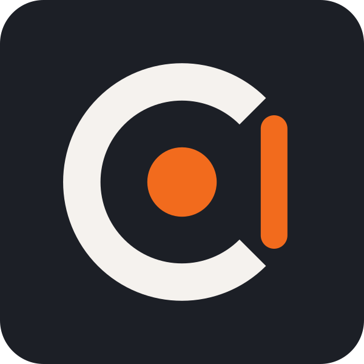
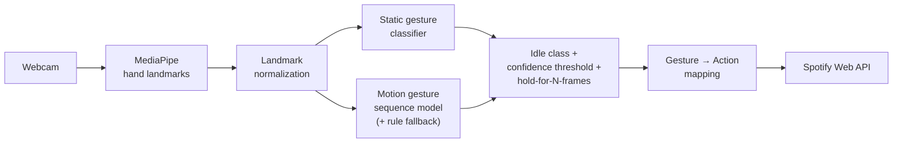

<p align="center">
  
</p>

<h1 align="center">Cara</h1>

<p align="center"><strong>Control Spotify with your hands.</strong></p>

<p align="center">
  
  
  
</p>

> [!NOTE]
> **Status: pre-alpha, working on Milestone 0.** Cara is being rebuilt from scratch. Everything below describes where it's going; features are tagged **(planned)** until they ship. See the [Roadmap](#roadmap) for progress.

Cara is a desktop app that watches your webcam, recognizes hand gestures, and turns them into Spotify actions: play, pause, skip, like, and adjust volume, without touching your keyboard.

**Why:** I wanted the Tony Stark experience from the early Iron Man films: waving at my computer and having it do things. Spotify felt like the right place to start.

---

## Table of contents

- [Features](#features)
- [Gestures](#gestures)
- [Requirements](#requirements)
- [Getting started](#getting-started)
- [Privacy](#privacy)
- [How it works](#how-it-works)
- [Repository layout](#repository-layout)
- [Roadmap](#roadmap)
- [Development](#development)
- [Model and data](#model-and-data)
- [Origins](#origins)
- [Contributing](#contributing)
- [License](#license)

---

## Features

- **Real-time hand tracking** from your webcam, running entirely on your machine **(planned)**
- **Static gestures**: hold a pose to play, pause, like, or unlike **(planned)**
- **Motion gestures**: swipe to skip to the next or previous track **(planned)**
- **Two-hand gestures**: control volume with both hands **(planned)**
- **Spotify remote control**: drives whichever device Spotify is currently playing on **(planned)**
- **False-trigger protection**: an idle class, a confidence threshold, and hold-to-confirm so normal desk movement doesn't change your music **(planned)**
- **Polished desktop UI** with a live landmark view **(planned)**
- **Linux executable** (Windows and macOS later) **(planned)**

## Gestures

Gesture-to-action mappings are **fixed in v1**. Editable mappings may come later.

| Action | Gesture | Type |
|---|---|---|
| Play | Open palm | Static |
| Pause | Fist | Static |
| Like | Thumbs up | Static |
| Unlike | Thumbs down | Static |
| Next track | Swipe right | Motion |
| Previous track | Swipe left | Motion |
| Volume up / down | One hand holds two fingers side by side; the other hand's index finger moves up or down | Two-hand |

> [!NOTE]
> All gestures are subject to change as the models are trained, and the volume gesture especially.

When you aren't making a gesture, Cara sees **idle** and does nothing. A gesture only fires once it's recognized with high confidence and held for several consecutive frames.

## Requirements

**To use Cara**

- Linux (Windows and macOS builds come after v1)
- A webcam. Decent, even lighting improves recognition a lot.
- A **Spotify Premium** account (required by the Spotify Web API for playback control)
- Spotify open and active on some device (desktop app, phone, speaker…). Cara is a **remote control**, not a player: it doesn't play audio itself.

**To train models** (development only, not needed to use Cara)

- An NVIDIA GPU
- [Docker](https://docs.docker.com/engine/install/) and the [NVIDIA Container Toolkit](https://docs.nvidia.com/datacenter/cloud-native/container-toolkit/latest/install-guide.html)
- Python 3, for the landmark viewer and training scripts

## Getting started

> [!IMPORTANT]
> There's no release yet. These steps describe how setup will work once v0.1 ships.

### 1. Install Cara

Download the Linux build from the [Releases](../../releases) page **(planned)**.

### 2. Connect Spotify

Spotify apps in development mode only allow users the app owner has added by hand. Cara uses OAuth PKCE, which needs no client secret, so you can safely use **your own** Spotify app:

1. Go to the [Spotify Developer Dashboard](https://developer.spotify.com/dashboard) and create an app.
2. Add Cara's redirect URI (shown in Cara's settings) to the app's **Redirect URIs**.
3. Copy the app's **Client ID**.
4. In Cara, open **Settings → Spotify**, paste the Client ID, and log in.

**Alternative:** if you'd rather not register an app, open an issue asking to be allowlisted on the maintainer's Client ID. Spots are limited.

The reasoning is recorded in [ADR 0001](docs/adr/0001-bring-your-own-spotify-client-id.md).

### 3. Gesture

Start playing something on Spotify, sit in front of your webcam, and try an open palm.

## Privacy

- **Camera frames never leave your machine.** Hand tracking and gesture recognition run locally.
- **The only network traffic is to Spotify**, for logging in and sending actions.
- **No telemetry and no crash reporting.** If that ever changes, it will be opt-in and documented here.
- Your Spotify token and settings are stored locally.
- **Training videos are deleted after import (planned).** When someone contributes hand videos for training, only the extracted landmarks are kept, under a pseudonymous ID. The videos themselves are never stored or committed.

## How it works



Cara has two halves that never ship together:

### The app (shipped)

| Concern | Choice |
|---|---|
| Desktop shell | Electron, packaged with electron-builder |
| Hand tracking | MediaPipe in JS (`@mediapipe/tasks-vision`) |
| Inference | Exported gesture models (TF.js / ONNX). No Python at runtime. |
| Local storage | SQLite / JSON for settings, mappings, and the Spotify token |
| Music | Spotify Web API, OAuth PKCE |

### The training stack (local development only)

| Concern | Choice |
|---|---|
| Data collection | The app's Dev UI, using the same JS MediaPipe tracker as inference ([ADR 0002](docs/adr/0002-record-landmarks-in-the-app-pipeline.md)); Python + MediaPipe + OpenCV is only a camera/landmark viewer |
| Training | TensorFlow on GPU |
| Dataset | PostgreSQL holding landmarks and metadata (label, recording session, hand, conditions) |
| Environment | Docker for the GPU training container and Postgres (not used for deployment) |

### Key design decisions

- **Landmarks, not video.** The dataset stores hand landmark coordinates rather than raw video. It's smaller and keeps faces and rooms out of it.
- **One normalization spec.** Landmark preprocessing is defined once as a written spec with test vectors. The Python training code and the JS app must both pass them, so the model sees identical inputs in training and in production.
- **Right-sized models.** Static gestures use a small landmark classifier. Motion gestures use a sequence model (LSTM or 1D-CNN over ~30 frames), with a rule-based fallback for swipes and volume.
- **Idle is a class.** The model is trained to recognize "no gesture" explicitly, rather than forced to pick a gesture for every frame.

## Repository layout

```
cara/
├── app/        # Electron app (shipped)
├── training/   # Python data collection, training, Docker + Postgres (dev only)
├── spec/       # Landmark normalization spec + shared test vectors
├── docs/       # Design docs, ADRs, assets
└── GLOSSARY.md # Project vocabulary
```

## Roadmap

Detailed progress lives in the [Roadmap issue](https://github.com/edwardseoj/Cara/issues/2); a box below is ticked when its milestone closes.

- [x] **0. Setup**: repo, Docker training stack + Postgres, Python script showing the camera feed with landmarks
- [x] **0.5. Spotify spike**: register an app, OAuth PKCE login, play/pause from a script
- [x] **1. Normalization spec**: shared landmark preprocessing spec + test vectors (Python and JS both pass)
- [ ] **2. Dev UI**: Electron with live landmarks, record mode (pick a label → save frames to Postgres), start-training button
- [ ] **3. Static gestures**: play, pause, like/unlike + idle. Train, export, run inference in JS with threshold + hold-N-frames
- [ ] **4. MVP v0.1**: connect gestures to Spotify (Linux build)
- [ ] **5. Motion gestures**: next / previous (sequence model, rules fallback)
- [ ] **6. Two-hand gestures**: volume
- [ ] **7. v1**: hit the reliability targets, polished UI, logo
- [ ] **8. Post-v1**: Windows/macOS builds via GitHub Actions, OS window controls (maximize, minimize, scroll)

### What "reliable" means for v1

| Metric | Target |
|---|---|
| Accuracy on held-out recording sessions | ≥ 95% |
| False triggers during normal desk use | < 1 per 10 minutes |
| End-to-end latency | < 100 ms |

The dataset must also include hands from at least 2–3 people besides me before Cara counts as reliable.

## Development

Design material lives in [`docs/`](docs/) and grows alongside the code:

- [`GLOSSARY.md`](GLOSSARY.md): the project's vocabulary (gesture, action, mapping, idle, …)
- [`docs/adr/`](docs/adr/): architecture decision records
- `spec/`: landmark normalization spec and test vectors (Milestone 1)
- [`docs/training.md`](docs/training.md): training stack, viewer, data collection and training workflow

## Model and data

Trained model weights may be published with releases. The landmark dataset will not be.

## Origins

Cara is a ground-up recreation of [**Calira**](https://github.com/edwardseoj/Calira-HandRecognition), a college group project that recognized static hand symbols in real-time video with a deployed model. Cara extends it with motion and two-hand gestures, Spotify control, a handmade dataset, GPU training, and a proper desktop app.

Cara is short for Calira, because Calira was a mouthful.

## Contributing

This is a solo project. Issues (bug reports, ideas, allowlist requests) are welcome, but pull requests aren't being accepted for now.

## License

[MIT](LICENSE)
